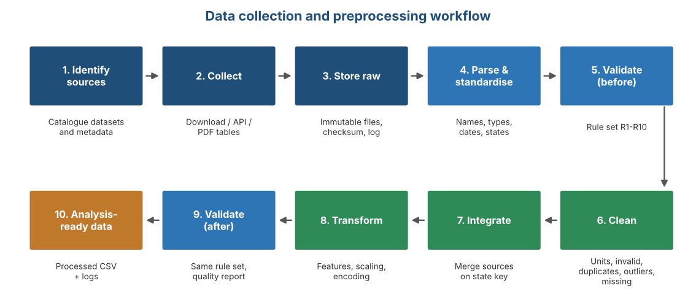
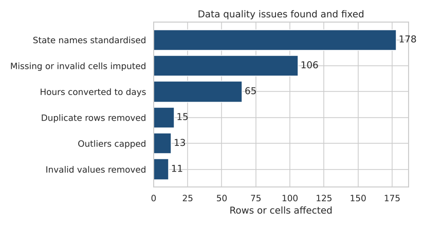
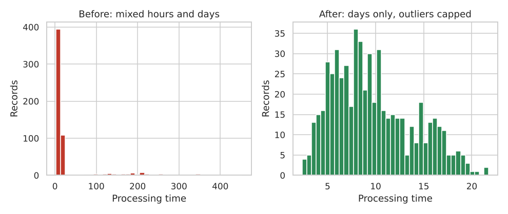
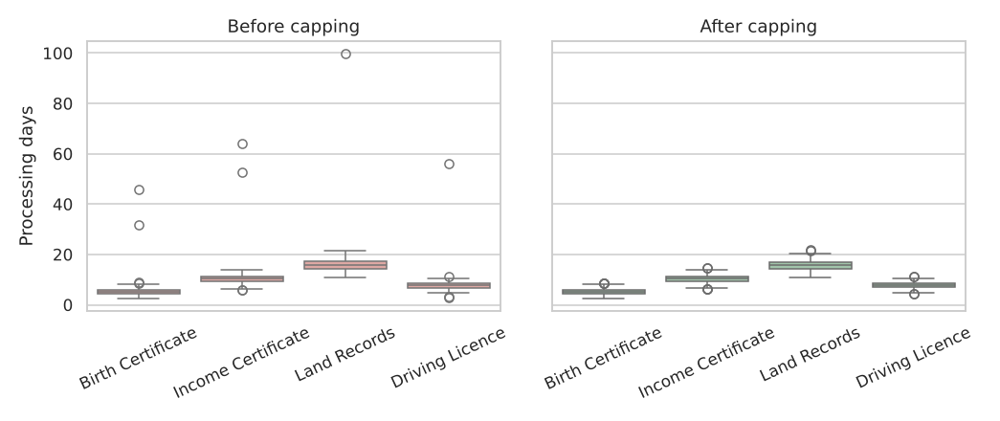
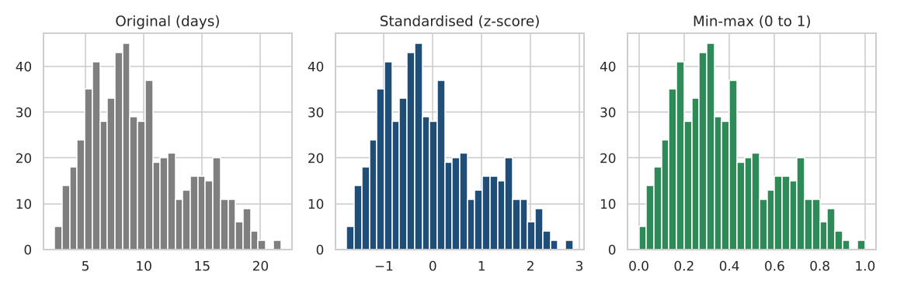
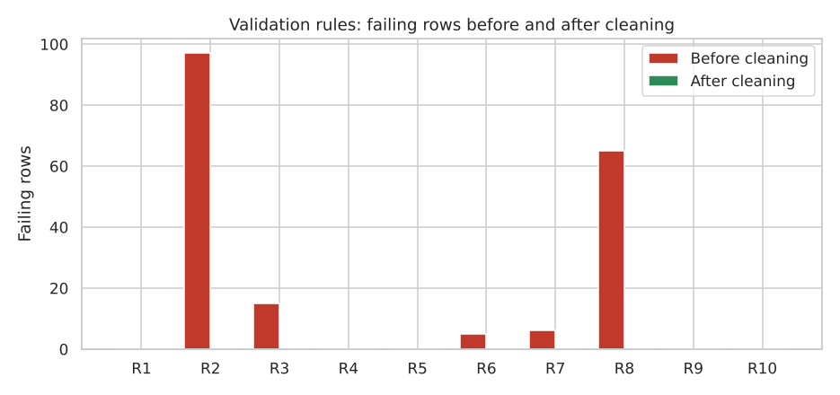

# E-Governance Service Delivery Analytics
### Week 2: Data Collection and Preprocessing Framework


A reproducible Python framework that takes messy public data about digital government services from **raw files to clean, validated, analysis-ready data**. It was built as part of a data analytics internship project on digital services and e-governance.

> **Data note:** the raw files in this project are **simulated** to look like messy public data (mixed date formats, state-name variants, NA tokens, hours mixed with days, duplicates and impossible values). Numbers in this README describe the **method only** and are **not real government statistics**.

---

## Table of Contents

1. [Project Overview](#project-overview)
2. [Key Results](#key-results)
3. [Workflow](#workflow)
4. [Public Data Sources](#public-data-sources)
5. [Pipeline Stages](#pipeline-stages)
6. [Results and Charts](#results-and-charts)
7. [Validation Rules](#validation-rules)
8. [Data Quality Report](#data-quality-report)
9. [Time Estimate](#time-estimate)
10. [Tech Stack](#tech-stack)
11. [Project Structure](#project-structure)
12. [How to Run](#how-to-run)
13. [Using Real Data](#using-real-data)
14. [Limitations](#limitations)
15. [Next Steps](#next-steps)

---

## Project Overview

Public data on digital services is rarely analysis-ready. It arrives in different formats, with inconsistent state names, numbers stored as text, mixed units, duplicates and missing values. This project defines and tests a ten-stage framework that:

- records **metadata** for every collected file (source, date, rows, columns, checksum)
- **standardises** column names, text, dates, numbers, units and state names
- runs a reusable **validation rule set** before and after cleaning
- **cleans** data (invalid values, duplicates, outliers, missing values)
- **integrates** service performance data with digital readiness indicators
- **transforms** data (feature engineering, scaling, encoding)
- produces **logs, charts and a quality report** so every step is traceable

## Key Results

| Raw records (Source A) | Clean records | Validation rules passed | Failing rows | Analysis-ready columns |
|---|---|---|---|---|
| 591 | 576 | 5 to 10 of 10 | 188 to 0 | 33 |

Raw records in Source A: **591**, clean records after processing: **576** (the difference is the duplicate rows that were removed).

## Workflow



## Public Data Sources

Candidate public sources that represent digital services and e-governance. Formats and update frequency are typical and must be verified on each website before collection. The full catalog (terms-of-use notes, key fields, expected issues) is in the Excel workbook, sheet **Dataset Catalog**.

| ID | Source | Publisher | Website | Typical format | Granularity |
|---|---|---|---|---|---|
| DS-01 | Open Government Data Platform: service and scheme datasets | Government of India (NIC) | data.gov.in | CSV, XLS, JSON, API | State, district, year or month |
| DS-02 | CPGRAMS grievance reports | DARPG | pgportal.gov.in | Web reports, PDF, some data files | Ministry or state, month |
| DS-03 | NeSDA assessment of state service portals | DARPG | darpg.gov.in | PDF reports | State, department |
| DS-04 | Digital India programme dashboards and reports | MeitY | digitalindia.gov.in | Web pages, PDF | National, state |
| DS-05 | Telecom performance indicator reports | TRAI | trai.gov.in | PDF, Excel | Telecom circle |
| DS-06 | Household digital access and skills surveys | MoSPI (NSO) | mospi.gov.in | PDF, unit-level data | State, national |
| DS-07 | UN E-Government Survey and EGDI | UN DESA | publicadministration.un.org | Excel, CSV, PDF | Country |
| DS-08 | World Bank Open Data indicators | World Bank | data.worldbank.org | CSV, XML, API | Country, year |

## Pipeline Stages

The notebook `egov_week2_preprocessing.ipynb` runs these stages in order:

1. Setup
2. Collect raw data (simulated) and log metadata
3. Parse and standardise (types, names, dates, units)
4. Validation rule set (used before and after cleaning)
5. Clean the data
6. Integrate Source B and engineer features
7. Validate again and build the quality report
8. Charts
9. Export the HTML quality report

Techniques used: SHA-256 checksums for raw files, IQR outlier capping per service, group-median and K-nearest-neighbour imputation (`KNNImputer`), `StandardScaler` and `MinMaxScaler`, one-hot encoding, and rule-based validation.

## Results and Charts

### 1. Issues found and fixed



The raw extract had 178 rows with non-standard state names, 65 processing times recorded in hours, 11 impossible values, 15 duplicate rows and 13 extreme outliers. 106 missing or invalid cells (including the impossible values) were filled and flagged.

### 2. Processing time: before and after



Mixing hours with days stretched the raw distribution into a long tail. After unit conversion and outlier capping the values sit on one consistent scale.

### 3. Outlier capping by service



Boxplots show extreme values per service before capping. 13 values were capped at the IQR bounds instead of being deleted, so no records were lost.

### 4. Effect of scaling



Standardisation (mean 0, standard deviation 1) and min-max scaling (0 to 1) change the scale but not the shape of the distribution. Both versions are kept for later modelling.

### 5. Validation before and after



5 of 10 rules passed before cleaning and 10 of 10 after. Failing rows fell from 188 to 0.

## Validation Rules

Ten rules run before and after cleaning. A rule passes when the number of failing rows is zero.

| Rule | Description | Dimension | Failing before | Failing after | Result |
|---|---|---|---|---|---|
| R1 | Key columns (state, service, month) are complete | Completeness | 0 | 0 | PASS |
| R2 | Measure columns have no missing values | Completeness | 97 | 0 | PASS |
| R3 | Each state-service-month appears once (unique key) | Uniqueness | 15 | 0 | PASS |
| R4 | Requests are zero or positive | Validity | 0 | 0 | PASS |
| R5 | Processing time is greater than zero | Validity | 0 | 0 | PASS |
| R6 | Resolution rate is between 0 and 100 | Validity | 5 | 0 | PASS |
| R7 | Satisfaction is between 1 and 5 | Validity | 6 | 0 | PASS |
| R8 | Processing time is recorded in days (single unit) | Consistency | 65 | 0 | PASS |
| R9 | Month is inside the study period 2025-01 to 2025-12 | Timeliness | 0 | 0 | PASS |
| R10 | State is one of the 12 study states | Consistency | 0 | 0 | PASS |

## Data Quality Report

**Completeness of measure columns (raw vs clean)**

| Measure | Raw missing cells | Raw completeness | Clean missing cells | Clean completeness |
|---|---|---|---|---|
| Requests | 14 | 97.6% | 0 | 100.0% |
| Processing time | 18 | 97.0% | 0 | 100.0% |
| Resolution rate | 33 | 94.4% | 0 | 100.0% |
| Satisfaction | 35 | 94.1% | 0 | 100.0% |

**Issues handled during cleaning**

| Issue handled | Rows / cells affected |
|---|---|
| State name variants (case, dots, spaces, old names) | 178 |
| Processing time recorded in hours | 65 |
| Resolution rate outside 0-100 | 5 |
| Satisfaction outside 1-5 (sentinel 99) | 6 |
| Repeated state-service-month records | 15 |
| Extreme processing times (IQR rule per service) | 13 |
| Missing or invalid measure values | 105 |
| Source B rows for states outside the study (e.g. Goa) | 1 |
| Missing digital readiness value in Source B | 1 |
| Study-state rows with no match in Source B (Telangana) | 48 |

## Time Estimate

The planned effort for this task, in hours (the brief expects roughly 30 to 35 hours):

| Task | Phase | Hours |
|---|---|---|
| Research and shortlist public datasets, build catalog | Collection | 4 |
| Design collection methods and storage structure | Collection | 4 |
| Set up raw storage, metadata log and checksums | Collection | 3 |
| Parse and standardise (names, types, dates, units) | Preprocessing | 4 |
| Missing value strategy and imputation | Preprocessing | 3 |
| Duplicates, outliers and invalid values | Preprocessing | 3 |
| Integrate sources and engineer features | Preprocessing | 3 |
| Scaling and encoding | Preprocessing | 2 |
| Validation rules and quality report | Validation | 4 |
| Documentation and final DOC | Reporting | 4 |
| **Total** |  | **34** |

## Tech Stack

| Area | Tools |
|---|---|
| Language | Python 3.9+ |
| Data handling | pandas, NumPy |
| Imputation and scaling | scikit-learn (`KNNImputer`, `StandardScaler`, `MinMaxScaler`) |
| Visualisation | matplotlib, seaborn |
| Reporting | Jupyter Notebook, self-contained HTML report, Excel workbook |

## Project Structure

```
project/
├── egov_week2_preprocessing.ipynb   # full pipeline notebook
├── egov_week2_workbook.xlsx         # catalog, plans, rules, timeline, quality report
├── egov_quality_report.html         # self-contained report with charts
├── README.md
├── charts/                          # figures used in this README
├── data/
│   ├── raw/                         # original files, never edited
│   ├── interim/                     # partly processed files
│   └── processed/                   # cleaned_service_data.csv, analysis_ready.csv
└── logs/                            # metadata_log, cleaning_log, validation_report, metrics.json
```

## How to Run

1. Install Python 3.9 or newer.
2. Install the libraries:
   ```bash
   pip install pandas numpy matplotlib seaborn scikit-learn jupyter
   ```
3. Start Jupyter in the project folder:
   ```bash
   jupyter notebook
   ```
4. Open `egov_week2_preprocessing.ipynb` and choose **Run All**.
5. The notebook creates the folders it needs, regenerates the simulated raw files and writes `egov_quality_report.html`.

## Using Real Data

1. Download real extracts (see [Public Data Sources](#public-data-sources)) and follow each source's terms of use.
2. Save them in `data/raw/` using the same columns as the simulated files, and remove the notebook lines that regenerate the simulated files.
3. Extend the state-name variants dictionary as new spellings appear in the cleaning log.
4. Re-run the notebook and update the blue input values in the Excel workbook.

## Limitations

- The raw data is simulated, so results show how the method works, not real service performance.
- Dataset availability, formats and terms of use change over time and must be re-checked.
- Median and KNN imputation assume missing values follow patterns within a service; flag columns are kept so sensitivity checks can be run.
- Outliers are capped rather than deleted, which keeps all records but changes extreme values.

## Next Steps

- Replace the simulated files with real public extracts and re-run the pipeline.
- Use `data/processed/analysis_ready.csv` for exploratory analysis (Week 3).
- Add declarative validation (for example pandera or great_expectations) as the project grows.

---

**Author:** Rahul Kumar Rai | Data Analytics Internship Project
